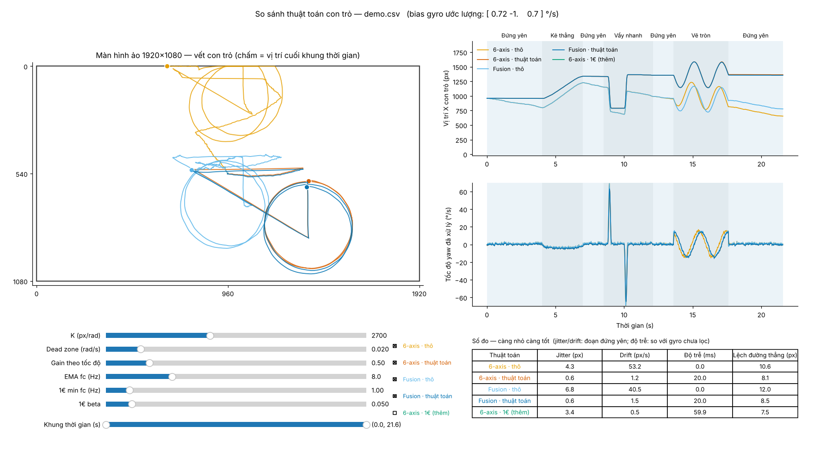

# imu-air-mouse

Công cụ **offline** để so sánh các thuật toán điều khiển con trỏ TV bằng gyro/accelerometer (air mouse).

Ghi log IMU một lần, phát lại qua nhiều thuật toán trên cùng dữ liệu, vẽ vết con trỏ chồng nhau, chỉnh tham số bằng slider và tự tính số đo.



## So sánh

Đầu vào đều là angular velocity, con trỏ dịch `Δ = K · ω · Δt`.

| | Thô (chỉ nhân K) | Có thuật toán |
|---|---|---|
| **6-axis** (ω gyro) | `6-axis · thô` | trừ bias, bù roll bằng accel, EMA, dead zone, gain theo tốc độ |
| **Fusion** (ω từ quaternion Mahony) | `Fusion · thô` | trừ bias, EMA, dead zone, gain theo tốc độ |

Ẩn mặc định, bật bằng checkbox:
- `6-axis · 1€`: dùng One Euro filter.
- `Quaternion chip`: dùng khi CSV có các cột `qw, qx, qy, qz`.

Các số đo:
- **Jitter (px):** độ rung khi đứng yên.
- **Drift (px/s):** tốc độ trôi khi đứng yên.
- **Độ trễ (ms):** so với gyro chưa lọc.
- **Lệch đường thẳng (px):** độ lệch khi kẻ thẳng.

## Chạy

Cần Python 3.9+, `numpy`, `pandas`, `matplotlib`.

```bash
python imu_viz.py demo.csv                       # cửa sổ tương tác
python imu_viz.py my_log.csv                     # log thật, gyro tính bằng vòng/giây
python imu_viz.py old_log.csv --gyro-unit rad    # log cũ theo rad/s (hoặc deg nếu là °/s)
python imu_viz.py demo.csv --save report.png     # xuất ảnh, không mở cửa sổ
python imu_viz.py --make-demo demo.csv           # tạo lại dữ liệu mẫu (mô phỏng)
```

## Định dạng CSV

**Chuẩn đơn vị đầu vào của cả repo: vận tốc góc tính bằng vòng/giây (rev/s)**, giống đầu ra của sensor. Tool Python và bản C++ đều nhận đúng đơn vị này, nên một file log dùng được cho cả hai. Bên trong, thuật toán tự đổi sang rad/s.

| Cột | Ý nghĩa |
|---|---|
| `t` | thời gian (s; thêm `--time-unit ms` nếu là ms) |
| `gx, gy, gz` | vận tốc góc, **vòng/giây** (1.0 = 360°/s). Log cũ theo rad/s hoặc °/s thì thêm `--gyro-unit rad` / `deg` |
| `ax, ay, az` | gia tốc (đơn vị bất kỳ) |
| `qw, qx, qy, qz` | *(tuỳ chọn)* quaternion của chip |
| `phase` | *(tuỳ chọn)* `still` / `line` / `flick` / `circle` — cần `still` để tính jitter/drift, `line` để tính độ lệch |

Quy ước trục: **X = mũi remote, Y = trái, Z = lên**. Nếu cảm biến gắn khác, dùng `--remap "x=y,y=-x,z=z"`.

`demo.csv` là dữ liệu **mô phỏng**, chỉ để thử tool.

## Bản C++

Thuật toán đã chốt (stillness lock + precision mode, low-pass filter, gain curve sigmoid, 2 thiết lập Độ nhạy / Độ ổn định) có bản C++ header-only trong [`cpp/`](cpp/), kèm ví dụ và hướng dẫn build.
